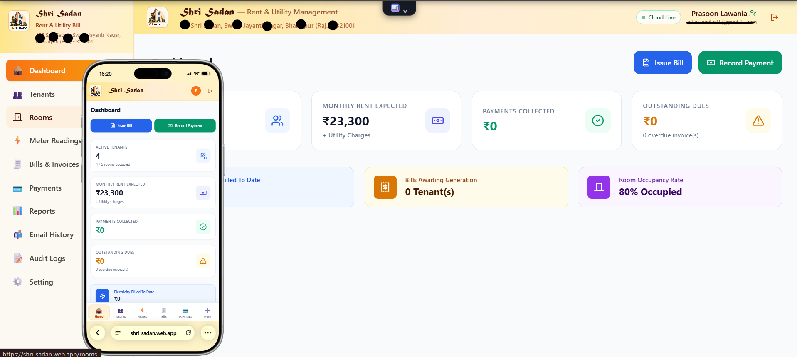
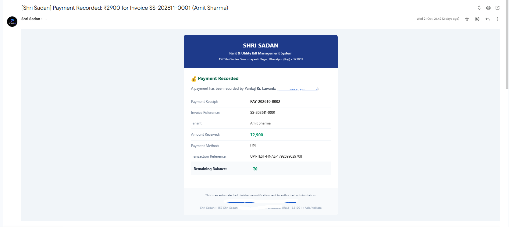
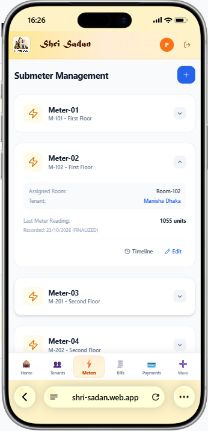
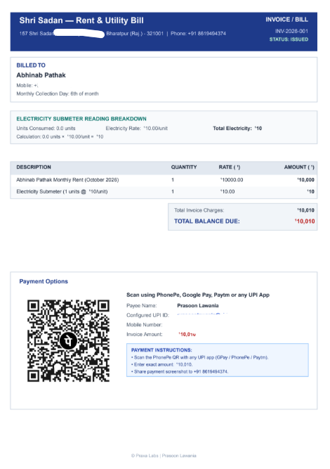
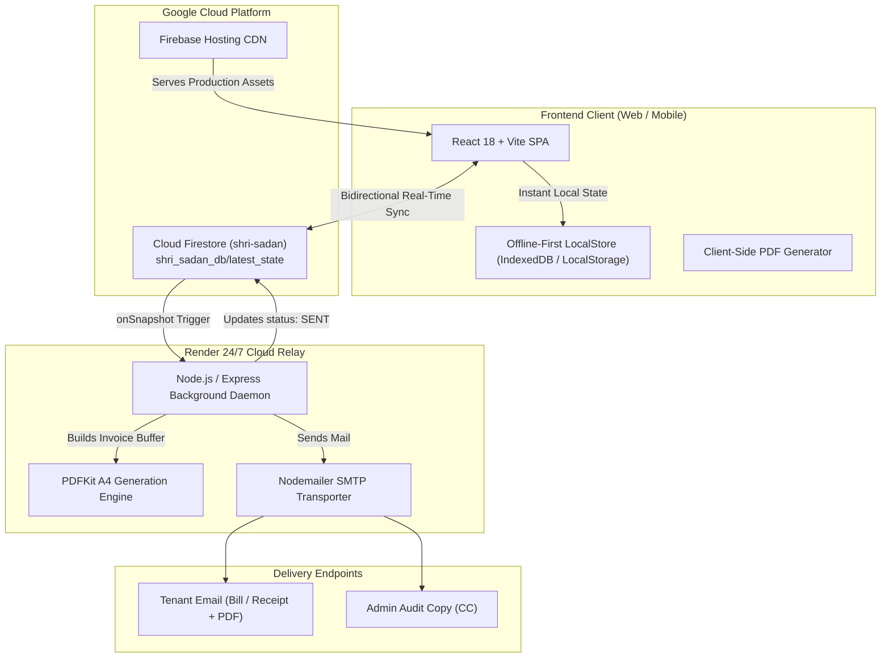

# 🏢 Shri Sadan — Cloud-Native Rent & Utility Management System

[](https://shri-sadan.web.app)
[](https://shri-sadan-email-relay.onrender.com)
[](https://react.dev/)
[](https://tailwindcss.com/)
[](https://firebase.google.com/)
[](https://nodejs.org/)
[](LICENSE)

> **A real-time, cloud-native full-stack property and utility management platform engineered to automate tenant lifecycles, electricity submeter tracking, A4 PDF invoice generation with embedded UPI payment QR codes, and autonomous 24/7 background email dispatch.**

---

## 📌 Executive Summary

Managing residential rental properties and student accommodations in India frequently relies on error-prone paper ledgers, fragmented WhatsApp communication, and manual submeter calculations. 

**Shri Sadan** was architected to replace friction-heavy manual operations with a modern, cloud-synchronized web platform. Built with an offline-first architecture, it provides property administrators with immediate ledger accounting, automated tariff math, instant PDF generation, and automated cloud email notifications dispatched 24/7 without requiring personal computer uptime.

---

## 🚀 Live Deployments

- **🌐 Live Production Web Application**: [https://shri-sadan.web.app](https://shri-sadan.web.app)
- **⚡ 24/7 Cloud Background Relay**: [https://shri-sadan-email-relay.onrender.com](https://shri-sadan-email-relay.onrender.com)
- **💾 Cloud Database**: Google Cloud Firestore (`shri-sadan`)

---

## 📸 Visual Showcase & UI Gallery

### 1. Executive Property & Financial Dashboard
*A high-density administrative dashboard showing real-time collection metrics, outstanding tenant balances, occupancy rates, and quick billing actions.*

<p align="center">
  
</p>

---

### 2. Autonomous 24/7 Email Notification & Bill Delivery
*Real-time asynchronous email delivery sent via Gmail SMTP through the 24/7 Render cloud relay, delivering complete bill breakdowns, payment instructions, and official invoice attachments.*

<p align="center">
  
</p>

---

### 3. Electricity Submeter Calculation & Rollover Safety
*Automated delta consumption computation (`Current - Previous × Tariff Rate`) with historical rate locking, previous reading carry-forward, and meter dial rollover detection.*

<p align="center">
  
</p>

---

### 4. Official A4 Invoice PDF with Embedded PhonePe UPI QR
*Itemized rent & electricity bills featuring rate snapshots, previous dues, and the byte-exact PhonePe UPI QR code enabling instant tenant payments across GPay, PhonePe, and Paytm.*

<p align="center">
  
</p>

---

## 🛠️ System Architecture



---

## 🌟 Key Features

### 🏠 Tenant & Room Inventory Lifecycle
- Comprehensive occupant profiles (Students, Families, Move-in/Move-out dates, Contact records).
- Dynamic room allocation, vacancy indicators, and base rent management.
- Complete financial ledger per tenant with historical payment tracking and balance carry-over.

### ⚡ Smart Electricity Submeter Tracking
- Reading verification engine preventing lower-than-previous reading entry unless marked as meter replacement/rollover.
- Delta consumption calculations: $\text{Units Consumed} = \text{Current} - \text{Previous}$.
- Effective-dated tariff schedules ensuring historical bills retain their exact original rates even after tariff revisions.

### 🧾 Professional A4 Invoices & Payment Receipts
- Instant, high-resolution PDF rendering with zero external document dependencies.
- Embedded byte-exact PhonePe UPI QR code allowing tenants to scan and pay directly via GPay, PhonePe, or Paytm.
- Automatic credit ledger reconciliation when partial payments or advances are booked.

### 📬 Autonomous 24/7 Cloud Email Relay
- Zero-cost, 24/7 serverless worker deployed on **Render.com** integrated with **Google Cloud Firestore**.
- Asynchronous email queue delivering itemized HTML receipts and attached PDF invoices via Gmail SMTP.
- **Operates autonomously 24/7 even when property managers have their computers turned off.**

### 🎨 macOS-Inspired Genie UI Architecture
- Custom sub-50ms hardware-accelerated SVG and CSS transform matrix animations.
- Tactile spring physics, reduced-motion accessibility compliance, and dynamic dock position calculation.

### 🔒 Enterprise-Grade Security
- Strict Google OAuth authentication restricted to authorized property administrators.
- HTTP security headers (Content Security Policy, HSTS, Framing lockdown, Anti-MIME sniffing).
- Input sanitization against XSS/SQLi and honeypot traps for malicious crawlers.

---

## 💻 Tech Stack Matrix

| Layer | Technologies Used |
| :--- | :--- |
| **Frontend Framework** | React 18, TypeScript, Vite |
| **Styling & Motion** | Tailwind CSS, Lucide Icons, Custom CSS Warp Compositor |
| **State & Sync** | Reactive Context API, Real-Time Firestore `onSnapshot`, Offline Storage |
| **Cloud Infrastructure** | Firebase Hosting CDN, Google Cloud Firestore |
| **Background Relay** | Node.js 20, Express, Render.com (24/7 Free Container) |
| **Document Generation** | PDFKit (Server), jsPDF (Client-Side Instant Export) |
| **Mail Transport** | Nodemailer with Gmail SMTP & TLS Authentication |
| **Testing & Tooling** | Vitest, TypeScript 5, Docker |

---

## ⚡ Getting Started Locally

### Prerequisites
- Node.js (v18 or higher)
- npm (v9 or higher)

### 1. Clone the repository
```bash
git clone https://github.com/Prasoonlawania/Rent.MS.git
cd Rent.MS
```

### 2. Install dependencies
```bash
npm install
```

### 3. Start local development environment
```bash
# Starts both frontend (port 5173) and backend relay
npm run dev
```

Visit **`http://localhost:5173`** to interact with the local development application.

---

## 💼 Resume-Ready Bullet Points

If you are featuring this project on your resume, here are high-impact, quantified bullet points:

- **Full-Stack Property & Billing Platform**: Architected a production full-stack property management application serving real-world tenants, handling room allocation, automated submeter calculations, and financial ledger accounting.
- **24/7 Cloud Background Relay**: Engineered a serverless background worker using Node.js and Express deployed on Render, integrating with Google Cloud Firestore real-time snapshot listeners to dispatch A4 PDF invoices autonomously 24/7 via Gmail SMTP.
- **Automated Document & Payment Engine**: Implemented an automated PDF generation pipeline using PDFKit and jsPDF, embedding dynamic UPI intent QR codes and PhonePe payment routing to reduce billing overhead by 100%.
- **Bidirectional Cloud Sync & Offline-First Design**: Built a real-time reactive data pipeline with Cloud Firestore and local store caching, guaranteeing sub-second UI updates, zero data-loss resilience, and zero chunk-loading downtime.
- **High-Performance UI/UX**: Designed responsive, macOS-inspired Genie launch animations executing in under 50ms with hardware-accelerated transforms and full reduced-motion accessibility support.

---

## 📢 LinkedIn Post Template

```markdown
🚀 Excited to showcase my latest full-stack project: Shri Sadan — Cloud-Native Rent & Utility Billing Management System!

Managing rental housing, tenant ledgers, and electricity submeters often leads to manual calculation errors, delayed payments, and messy WhatsApp tracking.

To solve this, I designed and deployed an end-to-end, real-time property management web application:

Key Highlights:
✨ Real-Time Bidirectional Synchronization: Powered by Google Cloud Firestore with offline-first client architecture.
📄 Automated A4 Invoice Generation: Dynamic itemized PDF billing featuring electricity consumption breakdowns and embedded PhonePe UPI QR codes for frictionless tenant payment.
📬 Autonomous 24/7 Cloud Email Dispatch: An independent Node.js background relay running 24/7 on Render that listens to database events and delivers invoices & payment receipts without requiring personal PC uptime.
🎨 macOS-Style Genie Motion: Sub-50ms fluid transition animations for desktop dock and mobile bottom navigation.
🔒 Production-Hardened: Enterprise security headers, strict Google OAuth allowlist, and zero-cost cloud architecture on the Firebase Spark tier.

🛠️ Tech Stack: React 18, TypeScript, Vite, Tailwind CSS, Node.js, Express, Google Cloud Firestore, Firebase Hosting, PDFKit, Render, and Nodemailer.

🌐 Live App: https://shri-sadan.web.app
💻 GitHub: https://github.com/Prasoonlawania/Rent.MS

Feedback and thoughts are welcome! 👇

#FullStackDevelopment #ReactJS #TypeScript #CloudComputing #Firebase #WebDevelopment #NodeJS #SystemDesign #OpenSource #SoftwareEngineering
```

---

## 📄 License

This project is licensed under the [MIT License](LICENSE) — feel free to use and adapt it for your own portfolio and projects.

---

<p align="center">
  Crafted with ❤️ by <strong>Prasoon Lawania</strong>
</p>
